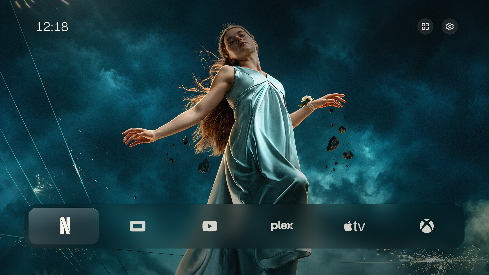
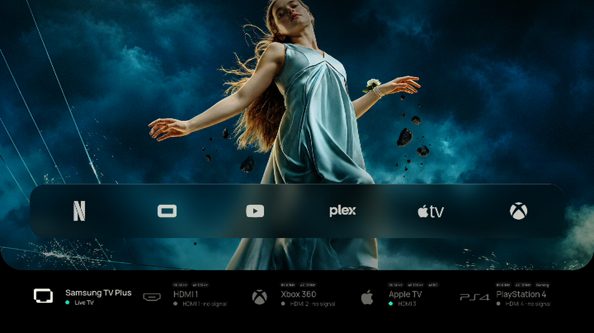

# tidyTizen

A focused, customizable home screen for Samsung Tizen TVs: six favorite apps, curated artwork, and a pull-down HDMI source tray without Samsung's advertising-heavy launcher.



Press Down to expose the TV's inputs. Names and platform icons can be changed independently for every source.



## What it does

- Discovers installed Tizen apps and lets you choose and order the apps on Home.
- Switches HDMI sources with the public Tizen TV Window API.
- Renames inputs locally and assigns bundled icons for Apple TV, Fire TV, Roku, Chromecast, Kodi, PlayStation, Xbox, Nintendo, PC, disc players, and more.
- Uses bundled scenery or user-curated movie and series backdrops from TMDB.
- Offers Dock/List layouts, icon/text modes, fonts, focus styles, and pre-rendered glass materials.
- Can experimentally intercept the physical Home key on the documented reference TV so Samsung Home never appears.

## Origin and credit

tidyTizen is an extensive adaptation inspired by and derived from Nathan Clark's [CleanFrame](https://github.com/nthnclrk/CleanFrame). CleanFrame's original code and documentation are MIT-licensed; its copyright notice is preserved in [LICENSE](LICENSE). This fork adds the QN800A/Tizen 6 interface, HDMI source tray and editor, TMDB curation, application changes, and the experimental TV-local Home interceptor.

This project is independent and is not affiliated with Samsung, TMDB, or any streaming or hardware brand. Brand marks identify their respective products; see [third-party notices](THIRD_PARTY_NOTICES.md).

## Reference TV and portability

The current interface was designed and tested for one `QN75QN800AFXZA`, firmware `T-OSCPAKUC-2220.9`, running Tizen 6.0. The source code is shared as a starting point, not a universal installer.

In particular, the HDMI capability pills are reference-TV annotations rather than negotiated signal data:

| Port | tidyTizen annotation on the reference TV |
| --- | --- |
| HDMI 1 and 2 | `8K 60Hz`, `4K 120Hz` |
| HDMI 3 | `8K 60Hz`, `4K 120Hz`, `eARC` |
| HDMI 4 | `8K 60Hz`, `4K 120Hz`, `Gaming` |

Another TV may expose different inputs, capabilities, application IDs, firmware behavior, or signing requirements. Adapt these labels and verify the result on your own hardware. The source name, port, and connection state come from Tizen; a custom name and icon are stored only in tidyTizen preferences. See [model-specific behavior](docs/model-specific-qn800a.md).

## Browser preview

Node.js 22+ and Python 3.10+ are recommended.

```sh
git clone https://github.com/ayala/tidyTizen.git
cd tidyTizen
npm ci
npm run dev:public
```

Open [localhost:4795/home/](http://localhost:4795/home/). Arrow keys, Enter, and Escape stand in for the TV remote. App launches, source switching, and Samsung screens require a TV.

## TMDB artwork

TMDB artwork is optional and requires every user to supply their own TMDB v3 API key. No key is included in this repository or its public widget.

```sh
cp app/assets/local-secrets.example.js app/assets/local-secrets.js
```

Then uncomment the assignment in `local-secrets.js` and replace the placeholder with your own key. The real file is ignored by Git. Private packaging includes it; `npm run export:public` always substitutes the empty example so a credential cannot be published in the public widget.

Artwork results refresh at most every six hours. The interface retrieves three movie and three series discovery pages, applies the selected genre/type exclusions, and lets the user select exact title backdrops. Only selected backdrops rotate, at the chosen interval, and rotation pauses while Home is hidden. Read [TMDB integration](docs/tmdb.md) for the full behavior and privacy boundary.

## Install on your own TV

A Tizen widget must be signed for the owner's TV and Samsung account. Create your own application identity, author certificate, and distributor certificate containing your TV's DUID. Do not reuse this reference installation's identity or certificates. Samsung's official setup links and the reference build boundaries are in [development](docs/development.md).

```sh
npm run check
TIDYTIZEN_PUBLIC_FONTS=1 npm run check:browser
npm run check:public
npm run export:public
```

The public export is unsigned and uses only bundled public fonts. Installation does not itself remap the physical Home button.

## Physical Home button

Samsung's normal web-app APIs cannot globally replace or suppress the Home key on this firmware. The working reference solution is an optional, owner-authorized, firmware-specific native experiment: a TV-local process exclusively grabs the physical remote input, forwards normal keys through `/dev/uinput`, withholds Home, and launches tidyTizen. A backed-up on-boot Samsung service starts the interceptor locally, so normal use does not depend on a Mac.

This requires elevated access and modifies a Samsung application slot. A mistake or firmware change can leave the TV in a recoverable but inconvenient state. Do not run it blindly. Preserve an off-device backup, validate rollback first, and adapt every model, firmware, input-device, and application-ID guard. The complete result, rejected approaches, persistence requirements, Back behavior, and rollback boundary are documented in [Home remapping on the QN800A](docs/home-remap-qn800a.md).

tidyTizen remains usable when opened like any normal app; the native Home experiment is not required.

## Repository safety

Never commit API keys, certificates, signing passwords, DUIDs, serial numbers, TV addresses, bridge tokens, recovery snapshots, proprietary fonts, or signed widgets. Machine-specific data belongs in ignored `.local/` or an off-repository backup. `npm run check:public` performs a bounded secret/path/font audit, but it is not a substitute for reviewing the staged commit and Git history.

## License

The original CleanFrame copyright and the tidyTizen modification copyright are retained in the [MIT license](LICENSE). Fonts, photography, TMDB imagery, product logos, and other third-party assets retain their own terms in [THIRD_PARTY_NOTICES.md](THIRD_PARTY_NOTICES.md).
